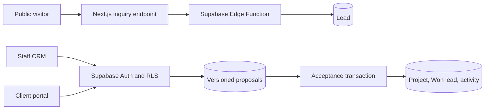

# AgencyDesk

An original agency CRM and client portal built with Next.js App Router, React, TypeScript, Tailwind CSS, Supabase, and Vercel. Website inquiry → lead → versioned proposal → client acceptance → project and milestones.

Live application: https://agencydesk-theta.vercel.app

CMS editing and recovery: [content workflow](infra/directus/CONTENT-WORKFLOW.md).
Responsibilities and future integrations: [content and automation](docs/content-and-automation.md).
Hosted rollout evidence: [CMS hosting gate](artifacts/cms-hosting-gate.md).

The public site and recruiter demo use fictional content. Reference projects were inspected only for engineering practices; no business data, copy, branding, designs, or assets were reused.

## Product and architecture

The staff CRM manages leads, owners, internal notes, follow-ups, contacts, proposals, and projects. Clients see their own proposals, milestones, shared updates, and comments. Administrator-generated invitation and recovery links require no SMTP provider. The independent recruiter demo is read-only.

Server Components read through a server-only data access layer; authenticated Server Actions validate writes. Supabase SSR uses cookies and server-verified identities. Privileged inquiry and invitation operations run in Edge Functions using their built-in secrets; Next.js needs no service-role key.



SQL migrations own grants, RLS, guards, and transactional RPCs. Acceptance derives `auth.uid()`, checks live company membership, locks lead → series → revision, and commits all handoff records together. Unique constraints and retry behavior prevent duplicate projects. Published scope, prices, and items cannot be edited. Internal records are separated from client-readable data; JWT user metadata never determines authorization.

Version one excludes payments, invoicing, uploads, campaigns, AI features, and multiple agency workspaces. Prices use USD integer cents. Scheduling inputs use Asia/Manila; Postgres stores `timestamptz`.

## Leads and automation, October 14, 2026

The live lead workspace now supports a paginated board/table view, owner filters, manual capture, explicit channel permissions, call outcomes, callback tasks, and an activity timeline. Manual creation and call logging use actor-scoped idempotent database commands; ordinary contact creation never starts an inquiry acknowledgment.

The Automations screen manages four rules: inquiry acknowledgment, proposal publication notice, a delayed proposal follow-up, and accepted-project confirmation. Rules start disabled and approval is required by default. CRM events queue frozen messages transactionally. Workers recheck consent, contact details, current proposal and membership; claim with leases; and track simulation, provider acceptance, and signed delivery receipts separately. Failed configuration or known rejection can be reset by an administrator; ambiguous sends require reconciliation.

Email uses an own-account Resend adapter. WhatsApp uses own-account Meta approved positional templates. The worker defaults to dry-run mode. Hermes Agent is optional for future drafts/triage and is not installed or connected. Inbound replies and AI conversation handling are not implemented. No ApartmentHub credentials, infrastructure, recipients, or i18n were imported.

See [messaging setup](docs/messaging-setup.md) for the exact own-account settings. Apply the three new October 14 migrations to the AgencyDesk database, deploy the updated `inquiry`, `automation-worker`, and `message-receipts` functions, configure secrets, and schedule the worker before enabling live delivery. Provider secrets live in Edge Functions; Next.js still needs no service-role key. [Explore the sample preview](http://localhost:3000/demo/automations).

New local checks: `pnpm test:database` includes all four isolated PostgreSQL suites; `pnpm test:edge` requires Deno 2 and executes the worker tests without network permission. Tests use only fictional records and fake providers. Hosted/provider delivery remains a separate test using the user's own account.

## Local setup

Use Node.js 22.18 or newer in the 22.x line and pnpm 10.28.1.

```sh
pnpm install --frozen-lockfile
cp .env.example .env.local
pnpm dev
```

Default `APP_MODE=demo` runs without credentials at `http://localhost:3000` and `/demo`.

For live mode, use a dedicated Supabase project:

| Variable | Purpose |
| --- | --- |
| `APP_MODE=live` | Enable authenticated CRM, portal, and writes |
| `NEXT_PUBLIC_SUPABASE_URL` | Project API URL |
| `NEXT_PUBLIC_SUPABASE_PUBLISHABLE_KEY` | Public application key |
| `SUPABASE_EDGE_ANON_KEY` | Legacy anon JWT used server-side for inquiry gateway |
| `APP_URL` | Origin used for invitation links |

Apply migrations in order, optionally load `supabase/seed.sql` into the development database, and deploy `inquiry` and `admin-invite` from `supabase/functions`. Keep inquiry gateway JWT verification enabled. The invitation function verifies the caller and requires an active database admin.

For local Supabase, start Docker Desktop before `npx supabase start`; `npx supabase db reset` loads migrations and fictional data. The seed creates no accounts or passwords.

Hosted Auth must disable public registration through Auth → Sign In / Providers → Allow new users to sign up, or Management API `disable_signup: true`. Local `config.toml` does not automatically configure hosted Auth. Keep the email provider enabled. Configure production and local confirmation URLs.

Bootstrap the first admin through Supabase's trusted administrator interface, then add their Auth user ID to `staff_members` with role `admin`. CRM access settings generate later invitation/recovery links. Clients need `can_accept_proposals=true` to accept or decline. Links open `/auth/confirm`, then `/auth/password`.

Google sign-in uses the same Supabase accounts and live memberships. Configure a Google Web OAuth client with the Supabase `/auth/v1/callback` URL, save its Client ID and Secret in the hosted Google provider, and allow `${APP_URL}/auth/callback` in Supabase Auth redirect URLs. Keep public signup disabled. Google testing-mode users must be listed in Google's Audience settings. The application exchanges the PKCE code into an SSR cookie session, verifies identity, and routes active staff to `/crm` or active clients to `/portal`. Users without membership are signed out locally and denied access. Google credentials do not belong in application code or browser environment variables. A real Google sign-in must verify that the existing invited user's ID and memberships remain intact; mocked callback tests do not prove account linking.

Vercel uses the Next.js preset, Node 22, and the pinned pnpm lockfile. Preview uses `APP_MODE=demo` with no production database credentials. Production uses `APP_MODE=live`, the dedicated hosted database, and Singapore functions. Build each environment separately; never promote a fixture-configured preview unchanged.

## Verification

```sh
pnpm lint
pnpm typecheck
pnpm test
pnpm test:database
pnpm build
pnpm exec playwright install chromium
pnpm test:e2e
```

The embedded PostgreSQL suite passes **44 assertions** covering actual RLS roles, isolation, live membership revocation, draft visibility, immutable publication, database totals, retry idempotence, superseded revisions, injected transaction rollback, and persistent inquiry limits. Only Supabase's external Auth schema is emulated.

The latest dedicated hosted project verification passed **17 Auth/Data API/RPC checks**, including two concurrent HTTP accepts returning one project ID, one project row, and one acceptance event. Evidence is in `artifacts/hosted-verification.json`. `pnpm test:hosted` uses private local test accounts and changes test records; run only against a dedicated test project. CI excludes this command.

Docker-backed Supabase tests were not run because the local daemon was unavailable. Saved pgTAP privilege checks can run with `npx supabase test db`. Browser tests cover responsive demo pages, accessibility, keyboard navigation, and read-only behavior. No unmeasured performance scores are claimed.

Supabase advisors reported no database authorization/function findings. Leaked-password protection remains an Auth advisory because the hosted setting requires Pro; no paid upgrade was made. See [Supabase password security](https://supabase.com/docs/guides/auth/password-security#password-strength-and-leaked-password-protection). Fresh-database unused-index notices are informational.

Inquiry briefs require 20–4,000 trimmed characters in application and Edge validation. The Edge Function derives the persistent rate key from normalized email; visitors cannot choose another key, read CRM tables, or invoke the privileged inquiry RPC directly.

GitHub Actions runs lint, type checks, unit tests, embedded database checks, production build, and demo browser tests without cloud credentials. Live Auth checks require invited test accounts and remain separate. The live browser suite verifies inquiry-to-project delivery, follow-ups, milestones, client comments, cross-company denial, invitation callbacks, and disabled signup. A successful client walkthrough is saved in `artifacts/walkthrough/client-workflow.webm`.

## Resume bullets

- Built a full-stack agency CRM and client portal using Next.js, React, TypeScript, Tailwind CSS, and Supabase, connecting lead capture, versioned proposals, and project delivery.
- Enforced company isolation with Postgres RLS and live membership, and implemented atomic acceptance using transaction locks and uniqueness constraints.
- Verified business rules with 44 PostgreSQL assertions and 17 hosted checks, including concurrent requests producing one project and one acceptance event.

Add performance or adoption figures only after measuring them.

## Interface simplification — October 3, 2026

The public site, CRM, and portal use a neutral palette, literal screen titles, and compact records. There is no approved logo; no wordmark or invented symbol is shown. Forms appear on request, demo records open into read-only details, and client sample views restrict navigation to the sample company. Interface conventions are recorded in DESIGN.md; product facts and user constraints are recorded in PRODUCT.md.
