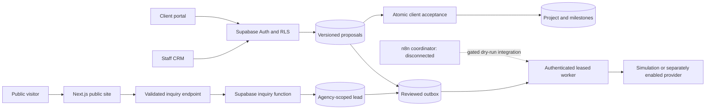

# AgencyDesk

A personal agency CRM and client portal demo built with Next.js 16, React 19, TypeScript, Tailwind CSS 4 and Supabase. It connects a public service inquiry to a reviewed lead, versioned proposal, client acceptance, and project delivery.

**[Open AgencyDesk](https://agencydesk-crm.netlify.app/)** · **[Explore the read-only demo](https://agencydesk-crm.netlify.app/demo)** · **[Sign in](https://agencydesk-crm.netlify.app/login)**

Public examples and demo records are fictional and labeled. They are not customer results, testimonials or operational metrics. The application is English-only.

## What is included

| Area | Current source behavior |
| --- | --- |
| Public website | Emerald visual theme, interactive procedural 3D homepage, service catalog/detail pages, sample projects and service-specific inquiry links. Readable no-JavaScript, reduced-motion and no-WebGL fallbacks. |
| Staff CRM | Task-first overview, lead board/table, URL filters and pagination, manual lead capture, owners, notes, call outcomes, callback tasks, contacts and a lead activity timeline. |
| Proposals | Versioned scope, line items and totals; publication locks the proposal snapshot. Client acceptance transactionally creates one project and its handoff records. |
| Client portal | Company-scoped proposals, projects, milestones, shared updates and comments. Internal staff records remain private. |
| Outbound review | Disabled-by-default event rules, frozen message previews, staff approval, separate email/WhatsApp consent, recipient suppression, leased processing, retries and uncertain-result reconciliation. |
| Services assistant | Public service guide and inquiry handoff. Hosted AI relay source is present, but model activation remains off pending provider configuration and evaluation. The assistant has no private CRM tools or records. |
| n8n | Separate protected, on-demand hosted demo with an imported inactive manual workflow. Hosted MCP, scheduled processing and CRM delivery credentials remain disconnected. |

Source availability does not prove a migration, provider connection or model is active in a hosted environment. Incoming email/WhatsApp conversations, authoritative calendar bookings, automatic cross-channel follow-ups and autonomous CRM agents remain unfinished. Callback tasks are internal reminders, not calendar reservations; delivery receipts are not incoming replies.

## Pages

| Route | Purpose |
| --- | --- |
| `/` | Public homepage and interactive 3D experience |
| `/services`, `/services/[slug]` | Service catalog and detail pages |
| `/case-studies` | Clearly labeled illustrative projects |
| `/inquire` | Public inquiry form and service selection |
| `/login` | Invited staff/client sign-in |
| `/crm` | Authenticated staff overview |
| `/crm/leads`, `/crm/leads/[id]` | Pipeline, contact details, activity and next actions |
| `/crm/tasks` | Follow-up task list |
| `/crm/contacts`, `/crm/proposals`, `/crm/projects` | Sales and delivery records |
| `/crm/automations`, `/crm/automations/setup` | Queue review, rules and connection guidance |
| `/crm/settings` | Staff/client access administration |
| `/portal` | Authenticated client workspace |
| `/demo` | Read-only fictional workspace; no live CRM access required |

## Architecture and data boundaries



- Server Components read through a server-only data layer. Server Actions validate mutations, and Supabase verifies live staff/client membership.
- SQL migrations own agency and company isolation, grants, RLS, publication guards and transactional commands. User-editable JWT metadata never determines authorization.
- Proposal acceptance uses transaction locks and uniqueness constraints to prevent duplicate projects. Published prices and scope cannot be edited in place.
- Public content is prepared into a validated build snapshot. The checked-in Netlify configuration uses `CONTENT_SOURCE=fixtures`; Directus is optional infrastructure, not an assumed live publishing service.
- Next.js does not require a Supabase service-role key. Provider credentials and privileged sending operations belong in server-side Edge Function secrets.
- Dates use `Asia/Manila` for scheduling inputs and `timestamptz` for storage. Proposal prices use USD integer cents. Private CRM routes do not load the public WebGL scene.

## Run locally

Requirements: **Node.js 22.18+ within the 22.x line** and **pnpm 10.28.1**. Use the versions declared in [package.json](package.json) and the committed lockfile.

```sh
pnpm install --frozen-lockfile
```

Copy the public configuration template, then start the app:

```powershell
Copy-Item .env.example .env.local
pnpm dev
```

On macOS/Linux, use `cp .env.example .env.local` for the copy step. Open [localhost:3000](http://localhost:3000) or [the local demo](http://localhost:3000/demo).

The template defaults to `APP_MODE=demo`, `CONTENT_SOURCE=fixtures` and `SERVICE_CHAT_ENABLED=false`. This mode needs no cloud credentials. Keep local environment files out of Git.

### Authenticated CRM setup

Live mode requires a dedicated, verified AgencyDesk Supabase project and invited accounts. It enables authenticated application writes; it does **not** automatically enable outbound sending or AI.

| Application variable | Purpose |
| --- | --- |
| `APP_MODE=live` | Enable authenticated CRM/portal flows and application writes |
| `NEXT_PUBLIC_SUPABASE_URL` | Own AgencyDesk project API URL |
| `NEXT_PUBLIC_SUPABASE_PUBLISHABLE_KEY` | Publishable browser application key |
| `SUPABASE_EDGE_ANON_KEY` | Server-side inquiry gateway JWT setting |
| `APP_URL` | Correct application origin for links and redirects |
| `CONTENT_SOURCE=fixtures` | Build public pages from the checked-in public catalog |
| `SERVICE_CHAT_ENABLED=false` | Keep hosted AI disabled until its separate activation gates pass |

1. Verify the intended account, project binding and actual migration history before applying the ordered files in `supabase/migrations/`. Do not infer deployment from checked-in SQL.
2. Deploy the needed functions from `supabase/functions/`, starting with `inquiry` and `admin-invite`. Preserve the inquiry gateway JWT check and the invitation function's active-admin authorization.
3. Disable public registration in hosted Supabase Auth. Local `config.toml` does not configure the hosted dashboard automatically. Set exact confirmation/callback redirect URLs for each environment.
4. Bootstrap the first Auth user and active `staff_members` administrator membership through the trusted database administration interface. Later invitations/recovery links come from CRM access settings. Client acceptance requires the appropriate live company membership and permission.
5. If using Google sign-in, configure the Google provider in Supabase and its exact `/auth/v1/callback`, then allow the application's `/auth/callback`. OAuth secrets stay in the provider configuration, never `NEXT_PUBLIC_*` values. Signing in without an active membership does not grant CRM/portal access.

Local Supabase development additionally needs Docker and the Supabase CLI. Database resets load migrations and the repository's fictional development seed; use only a disposable development database. Seed data creates no account passwords. Never reset a hosted project as a setup shortcut.

## Automation and integrations

The four initial rules cover inquiry acknowledgment, proposal publication, delayed proposal follow-up and accepted-project confirmation. Rules start disabled with approval required. Manual lead entry does not fabricate a website-inquiry event or automatically send its acknowledgment.

The worker defaults to **dry-run**. Simulated jobs become terminal queue records and are not replayed later as live sends. Eligibility, consent, suppression and lease ownership are rechecked before processing. Known failures and uncertain provider outcomes have different recovery paths; ambiguous results are not blindly retried.

Adapter source supports Resend/Gmail for email and Meta/Zoko/WAHA for WhatsApp. An adapter's existence does not establish a current authenticated connection, reachable WhatsApp host or permission to send. Gmail send-only access is separate from inbox-reading authorization. Hermes is optional draft-assistance source, not a connected autonomous operator.

n8n coordinates AgencyDesk's guarded integration boundary; it does not own approvals, consent, agency isolation, idempotency or outbox leases. Do not bypass those controls with direct provider nodes or SQL. The reviewed-source admission limit is five leases per rolling hour and twenty per Manila calendar day per agency, shared across channels and modes; excess work is deferred without consuming an attempt. Recurring processing stays off until the cap migration/deployment, error notification and authorized dry-run checks are verified. See [operating-cap rollout](docs/plans/2026-11-03-outbox-operating-caps.md).

The separate **[hosted n8n demo](https://agencydesk-n8n-demo.vercel.app/)** requires Vercel Authentication and the owner's n8n login. It uses dedicated Neon Free PostgreSQL storage and a stable private encryption key. It is an on-demand personal demo, not a verified always-on scheduler. The existing manual workflow is inactive/unconfigured; the local instance and hosted MCP connection are separate.

See the [messaging setup](docs/messaging-setup.md), [reviewed n8n queue boundary](docs/plans/2026-10-30-n8n-queue-boundary.md) and [current n8n hosting handoff](docs/n8n-hosting-handoff.md). Older dated provider guides describe their original rollout, not proof of present activation. Keep sending and scheduling disabled until the current safeguards and explicit activation requirements are satisfied.

## Checks

```sh
pnpm lint
pnpm typecheck
pnpm test
pnpm test:database
pnpm test:edge
pnpm build
pnpm exec playwright install chromium
pnpm test:e2e
```

- `pnpm test` runs application unit/render tests plus n8n hosting configuration guards.
- `pnpm test:database` exercises the checked-in migrations in embedded PostgreSQL, including roles/RLS, proposal acceptance, queue behavior, provider routing, recipient suppression, inquiry deduplication and service-chat quotas. It needs no hosted credentials.
- `pnpm test:edge` requires Deno 2; CI pins **2.5.6**. These tests use fake providers with runtime network access denied.
- Browser tests cover demo/public flows, responsive rendering, accessibility and navigation. Live account cases require explicitly configured invited test accounts and are separate from credential-free CI.
- `pnpm test:chat-concurrency` and `pnpm test:automation-concurrency` are explicitly opted-in disposable Docker/PostgreSQL tests. Read their fixture/setup requirements before running locally; CI runs the outbox concurrency guard in its own isolated container.
- `pnpm test:hosted` mutates dedicated hosted test records. It is excluded from normal CI and must not be pointed at production or another project.

[GitHub Actions](.github/workflows/ci.yml) runs lint, type checking, unit/database/Edge checks, content-build checks, production build and the credential-free browser suite. Read the checks on the exact PR commit. Historical test totals, a successful preview or a saved walkthrough do not certify the current application or live providers.

## Hosting and contribution workflow

- **CRM/public site:** [AgencyDesk on Netlify](https://agencydesk-crm.netlify.app/). Configuration is in [netlify.toml](netlify.toml); the existing target uses Netlify Free, with `main` for production and `preview` for review builds.
- **n8n personal demo:** separate protected Vercel Hobby Container target with dedicated Neon Free storage. Its [deployment source](infra/n8n/vercel-demo/README.md) is separate from the Next.js application. A hosted editor is not proof of reliable background scheduling.
- **Branches:** only `main` and `preview` on GitHub. Synchronize current upstream changes, publish reviewed scoped work to `preview`, and open/update a **`preview` → `main` PR**. The owner reviews and merges. Do not create extra remote branches, force-push or automatically promote production.
- **Configuration:** build each environment with its own settings. A fixture-mode preview is not automatically a live-mode release. Keep credentials, private `.local` stores, customer data and caches out of Git, CI artifacts and deployment uploads.
- **Costs:** keep this project free-only; no paid upgrades, trials with charges or automatic recharge. Provider activation is a separate decision. The personal-demo hosting choice does not establish eligibility for a future commercial deployment.

## Repository guide

| Path | Responsibility |
| --- | --- |
| `src/app/` | Public, CRM, portal, demo and authentication routes |
| `src/components/` | Shared interface, public 3D boundary and services assistant |
| `src/lib/` | Server data access, validation, content and workflow helpers |
| `supabase/migrations/` | Schema, RLS, grants and transactional business rules |
| `supabase/functions/` | Inquiry, invitations, delivery/receipts and gated assistant functions |
| `content/` | Public content fixtures and content definitions |
| `infra/directus/` | Optional public-content CMS and editor workflow |
| `infra/n8n/` | Reviewed manual workflow and separate hosted-demo runtime |
| `tests/` | Unit, database, Edge-related integration and browser verification |
| `docs/` | Setup, architecture, decisions and scoped verification reports |

Further reading: [branch workflow](docs/branch-workflow.md), [public content editing](infra/directus/CONTENT-WORKFLOW.md), [services assistant verification](docs/plans/2026-10-31-service-chat-source-verification.md), and [project constraints](AGENTS.md).
