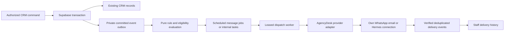

# AgencyDesk architecture and integration analysis

Reviewed 14 October 2026. Source: `C:/Users/paule/OneDrive/Documents/ChatGPT/agencydesk`, restored Git default branch `codex/directus-cms`, commit `861f4039761b7eb3ea9de01a93ab48c4f07a1649`.

This is a static source review. No live database, accounts, deployments, senders, or external workflows were exercised. This agent created only this report; the parent agent owns dependency installation and fresh verification. Saved repository artifacts and README test totals describe historical verification, not checks rerun by this review.

## Main finding

AgencyDesk already has a substantial working CRM backend. The right integration is to extend its existing leads, contacts, tasks, proposals, projects and Supabase memberships with selected ApartmentHub behavior. Its missing piece is reliable outbound messaging and richer interaction history. Replacing the CRM or importing ApartmentHub's multiple auth systems would discard useful transactional and authorization work.

AgencyDesk is a **single-agency application** with company-isolated client access. `company_id` identifies a client company, not an agency tenant. Leads can exist before a client company is assigned. Do not add a mandatory organization/workspace ID merely because a generic donor blueprint includes one. No i18n framework or locale routes are needed; current presentation already uses English, USD integer cents and Manila scheduling.

## Implemented surfaces

| Surface | Actual source behavior | Evidence |
|---|---|---|
| Public site | Home, services, case studies and inquiry form; copy comes from a validated build snapshot | [website content reader](C:/Users/paule/OneDrive/Documents/ChatGPT/agencydesk/src/lib/website-content.ts:1), [snapshot preparation](C:/Users/paule/OneDrive/Documents/ChatGPT/agencydesk/scripts/prepare-content.mjs:5) |
| Demo | Separate fictional records; independent read-only detail pages, pipeline view and sample client portal | [fixtures](C:/Users/paule/OneDrive/Documents/ChatGPT/agencydesk/src/lib/fixtures.ts:1), [demo detail route](C:/Users/paule/OneDrive/Documents/ChatGPT/agencydesk/src/app/demo/[section]/[id]/page.tsx:1) |
| Live CRM | `/crm` plus leads, contacts, proposals, projects, tasks and admin settings; server-side authenticated reads/writes | [CRM layout](C:/Users/paule/OneDrive/Documents/ChatGPT/agencydesk/src/app/crm/layout.tsx:1), [data layer](C:/Users/paule/OneDrive/Documents/ChatGPT/agencydesk/src/lib/data.ts:9) |
| Client portal | Permitted proposal revisions, project milestones, shared updates and comments | [proposal detail](C:/Users/paule/OneDrive/Documents/ChatGPT/agencydesk/src/app/portal/proposals/[id]/page.tsx:1), [project detail](C:/Users/paule/OneDrive/Documents/ChatGPT/agencydesk/src/app/portal/projects/[id]/page.tsx:1) |
| Access | Password or Google login; membership-based destination; admin generates private invitation/recovery links | [login actions](C:/Users/paule/OneDrive/Documents/ChatGPT/agencydesk/src/app/login/actions.ts:8), [membership routing](C:/Users/paule/OneDrive/Documents/ChatGPT/agencydesk/src/lib/login-destination.ts:4), [invitation function](C:/Users/paule/OneDrive/Documents/ChatGPT/agencydesk/supabase/functions/admin-invite/index.ts:3) |
| CMS | Directus manages four public-content collections; admin-only version preview; build-time published snapshot; prepared deployment flows | [CMS workflow](C:/Users/paule/OneDrive/Documents/ChatGPT/agencydesk/infra/directus/CONTENT-WORKFLOW.md:1), [flow generator](C:/Users/paule/OneDrive/Documents/ChatGPT/agencydesk/infra/directus/publishing-flows.mjs:17) |

`APP_MODE` defaults to demo unless explicitly `live` ([env.ts](C:/Users/paule/OneDrive/Documents/ChatGPT/agencydesk/src/lib/env.ts:1)). CRM and portal layouts redirect to demo surfaces in demo mode, and every business mutation rejects demo mode. `CONTENT_SOURCE` is independent: fixtures or Directus. A production CMS-backed site does not prove messaging exists.

The richer demo pipeline UI is not currently the live leads screen. Demo uses client-side `LeadsView` with search and a board; live `/crm/leads` uses a paginated table and server filters. Demo proposal values/status and project due dates also contain fixture-only enriched fields; live proposals store those details on revisions, and the projects table has no project due-date column. Treat visual parity as an implementation task, not an existing feature.

## Actual inquiry-to-delivery flow

1. Inquiry form posts to `/api/inquiries`. The endpoint rejects demo mode, foreign origins, oversized input and invalid briefs/budgets ([route](C:/Users/paule/OneDrive/Documents/ChatGPT/agencydesk/src/app/api/inquiries/route.ts:4)).
2. Server-only forwarding invokes the Supabase inquiry Edge Function. The function derives a rate key from normalized email, then calls the privileged database RPC ([forwarder](C:/Users/paule/OneDrive/Documents/ChatGPT/agencydesk/src/lib/supabase/inquiry.ts:5), [Edge function](C:/Users/paule/OneDrive/Documents/ChatGPT/agencydesk/supabase/functions/inquiry/index.ts:14)). `submit_inquiry` uses an advisory transaction lock, allows five submissions per email/hour, and atomically records the lead plus `inquiry_received` activity ([SQL](C:/Users/paule/OneDrive/Documents/ChatGPT/agencydesk/supabase/migrations/20261002054409_agencydesk_core.sql:268)). This is persistence, not an acknowledgment message send.
3. Staff link the lead to a company, choose owner/stage, add private notes and manually create or complete follow-up tasks ([lead detail](C:/Users/paule/OneDrive/Documents/ChatGPT/agencydesk/src/app/crm/leads/[id]/page.tsx:7), [task screen](C:/Users/paule/OneDrive/Documents/ChatGPT/agencydesk/src/app/crm/tasks/page.tsx:7)). A task's due time never invokes a sender in current source.
4. Staff create a proposal series tied to the same lead/company, create revisions, add priced line items and publish. Publishing locks the lead, series and revision; calculates the full price in SQL; supersedes the previous published version; marks the lead `proposal_sent`; and writes `proposal_published` ([SQL](C:/Users/paule/OneDrive/Documents/ChatGPT/agencydesk/supabase/migrations/20261002054409_agencydesk_core.sql:206)). **`proposal_sent` currently means published in the portal, not delivered by email or WhatsApp.** Preserve this distinction in any delivery dashboard.
5. An authorized client accepts through a database RPC. It reads live accepting membership and locks that membership before committing. In one transaction it records the accepted revision, creates one project, marks the lead `won`, and writes `proposal_accepted`. Retry returns the original project ID; unique lead/revision project constraints provide additional protection ([SQL](C:/Users/paule/OneDrive/Documents/ChatGPT/agencydesk/supabase/migrations/20261002054409_agencydesk_core.sql:225), [project constraints](C:/Users/paule/OneDrive/Documents/ChatGPT/agencydesk/supabase/migrations/20261002054409_agencydesk_core.sql:63)). Acceptance does **not** automatically create milestones, notifications or an invoice.
6. Staff subsequently add/complete milestones and post shared updates; clients and staff comment on updates ([server actions](C:/Users/paule/OneDrive/Documents/ChatGPT/agencydesk/src/app/actions.ts:24)). These are database writes, not external sends.

Declining is also a guarded transactional RPC with an idempotent declined retry and activity record. Current decline logic does not set the lead lost. Business rules should use the actual proposal/lead state rather than assuming donor sales semantics.

## Identity, database and authorization

The schema contains `staff_members`, `companies`, `client_memberships`, `contacts`, `leads`, `lead_notes`, `follow_up_tasks`, `proposal_series`, `proposal_revisions`, `proposal_items`, `projects`, `milestones`, `project_updates`, `comments`, `activity_events` and private inquiry-rate records ([core schema](C:/Users/paule/OneDrive/Documents/ChatGPT/agencydesk/supabase/migrations/20261002054409_agencydesk_core.sql:6)).

Server Components use a server-only data layer, and Server Actions authenticate and validate writes with Zod. SSR cookie session refresh runs through Next's `proxy.ts`; protected requests receive private/no-store headers. `requireStaff` checks the current database staff row, and `requireAdmin` checks admin role ([auth helpers](C:/Users/paule/OneDrive/Documents/ChatGPT/agencydesk/src/lib/auth.ts:6), [proxy](C:/Users/paule/OneDrive/Documents/ChatGPT/agencydesk/src/proxy.ts:6)). Authorization does not use editable user metadata.

All public CRM tables enable RLS and revoke anonymous access. Policies distinguish staff and current client-company membership. Clients cannot read internal leads, notes, contacts, follow-up tasks or activity events. They see their companies, proposal series and non-draft revisions/items, their projects, milestones, updates and comments. Staff are agency-wide users, not restricted to assigned leads. Admin alone manages staff/client membership. The second migration reorganizes policies without changing this model ([policies](C:/Users/paule/OneDrive/Documents/ChatGPT/agencydesk/supabase/migrations/20261002054409_agencydesk_core.sql:123), [policy refinement](C:/Users/paule/OneDrive/Documents/ChatGPT/agencydesk/supabase/migrations/20261002055202_policy_performance.sql:1)).

Private security-definer business functions explicitly check `auth.uid()` and live membership, fix `search_path`, and have explicit execute grants/revocations. Public transition wrappers are security invoker. Database triggers prevent editing published scope/items, changing proposal/project ownership, or manually marking a new lead won. Retain these protections when adding rule-driven behavior.

Next.js uses a publishable Supabase key and a server-side inquiry gateway key; privileged service-role use is confined to Supabase Edge Functions. The invitation function verifies the caller with Auth and a live admin membership before assigning access. It **generates a link only**; the admin manually shares it. There is no SMTP sender in that workflow.

## What automation exists today

Implemented business automation consists of transactional CRM transitions and inquiry rate limiting. There is no automatic outbound-message provider, message ledger, recipient queue, delivery webhook, retry worker, CRM scheduler or WhatsApp/Hermes adapter under the reviewed source.

Directus publication/visibility flows are separate public-content deployment automation. The generator creates them `inactive`; the workflow documentation records hook configuration as pending and both flows inactive. Admin settings can request a rebuild only when a server deploy hook is configured. These source facts cannot establish current hosted hook state ([flow status](C:/Users/paule/OneDrive/Documents/ChatGPT/agencydesk/infra/directus/publishing-flows.mjs:29), [rebuild action](C:/Users/paule/OneDrive/Documents/ChatGPT/agencydesk/src/app/crm/settings/content-actions.ts:4)). The automation document explicitly proposes a future transactional outbox and defers analytics/n8n/Zapier ([future automation](C:/Users/paule/OneDrive/Documents/ChatGPT/agencydesk/docs/content-and-automation.md:42)).

## Concrete ApartmentHub-to-AgencyDesk mapping

See [ApartmentHub CRM report](C:/Users/paule/OneDrive/Documents/ChatGPT/agencydesk/analysis/apartmenthub-crm.md) and [automation report](C:/Users/paule/OneDrive/Documents/ChatGPT/agencydesk/analysis/apartmenthub-automation.md) for donor evidence and defects.

| Useful donor concept | AgencyDesk integration point | Required adaptation |
|---|---|---|
| Kanban and contextual lead detail | Existing leads/stages, `/crm/leads`, lead detail | Bring live data into board interaction; stage commands must retain SQL won/ownership guards. No separate `sales_leads` replacement. |
| Multi-channel contact methods | Existing contacts and leads | Add normalized contact methods and explicit contact linkage if needed. Inquiry can remain unlinked initially. Phone/WhatsApp destination and preferences do not exist today. |
| Calls, outcomes, callbacks and pinned notes | Existing lead notes/tasks/activity | Add call activities and callback scheduling; pure outcome functions request guarded stage changes and tasks. Preserve English agency stages. |
| Aging and priority | Existing tasks due times and lead activity | Sort actionable work by deadline/last interaction; define agency-specific delays. Donor seven-day email aging means an internal call task, not an automatic second message. |
| Message preview, audience freeze and suppression | New staff-controlled automation UI | Use AgencyDesk contacts/companies; require current per-recipient eligibility and recheck before dispatch. Never carry donor recipients/templates. |
| Durable jobs and delivery history | New private outbox/worker plus staff activity UI | Use lease expiry/owner, deduplication, explicit unknown results and per-channel attempts; repair donor premature `sent_at` and creation-age reclaim flaws. |
| Hermes hook | Optional server provider adapter | Donor Hermes is an internal buyer-alert gateway with unfinished acknowledgment/idempotency contract. Confirm the user's actual endpoint/contract; a replacement API key alone is insufficient. |

Start with agency events already proven to commit: `inquiry_received`, `proposal_published`, `proposal_accepted`, `proposal_declined`. Extend task completion, project status, milestone completion and shared-update posting with transactional event emission when those rules are required. Appointments, document-chasing, invoicing and payments have **no current AgencyDesk model**; donor features in those categories require a separate product decision and schema work.

## Proposed integration design, not implementation

Create the outbox entry **inside** `submit_inquiry`, `private.publish_revision`, `private.accept_revision` and `private.decline_revision`, beside the existing activity insert. An external send after a Server Action succeeds can be lost if the process stops; a send inside acceptance would make a remote outage block project conversion. Committed event delivery should run separately and retry independently.

Suggested additions are a private business-event outbox, staff-managed rule/template versions, per-contact channel preferences, scheduled message jobs, attempts with lease owner/expiry, and a deduplicated provider-event inbox. Events reference existing lead/proposal/project/contact/company IDs; keep `company_id` nullable for unassigned inquiries. Client-visible project comments must not expose provider secrets, failure diagnostics or internal notes. Preserve staff-only automation administration initially; client preferences may later receive a narrowly scoped interface.

A server-only adapter accepts a rendered message/template snapshot, destination, stable idempotency key and AgencyDesk-owned connection reference. It returns `accepted`, `rejected` or `unknown` with a provider ID where available. Credentials stay in server environment/configuration; do not copy donor key values, accounts, recipients, sender IDs or template IDs. A dry-run adapter can validate the first slice without external delivery. Single-language UI/templates remain sufficient; an API-required template language code does not require application i18n.

Example first rules: inquiry acknowledgment; proposal published notification; staff follow-up task when a proposal remains undecided after a configured delay; internal project-start notification after accepted conversion; client notification for a posted shared update. A reminder must recheck current revision, expiry, decision, archival/suppression and destination eligibility immediately before sending. Accepted/superseded/cancelled work should invalidate old scheduled jobs. For outbound marketing, require affirmative consent separately from transactional delivery settings.

Do not claim external exactly-once delivery solely from SQL uniqueness. A crash after provider acceptance before storing the result is ambiguous; use provider idempotency or a reconciliation/manual-review state. Record accepted/delivered/read independently, consume duplicate/out-of-order events monotonically, and keep payload/contact information out of operational logs, following [current redacted logging](C:/Users/paule/OneDrive/Documents/ChatGPT/agencydesk/src/lib/operational-log.ts:3).

## Existing gaps to handle during adaptation

- Activity events currently cover inquiry/publication/acceptance/decline, not manual lead stage/owner changes, notes, tasks, milestone completion or project status. Add actor/from/to/reason and transactionally consistent events before building timeline-driven rules.
- `createContact` creates a company and contact in separate calls. If contact insertion fails, an orphan company can remain; a retried form can create another company. Use one transactional command or explicit existing-company selection when expanding contact management ([action](C:/Users/paule/OneDrive/Documents/ChatGPT/agencydesk/src/app/actions.ts:28)).
- `createRevision` calculates the next version from a separate read. Concurrent users can collide with `(series_id, version)` uniqueness and one receives an error. It does not corrupt data, but an atomic version allocator would improve editing ([action](C:/Users/paule/OneDrive/Documents/ChatGPT/agencydesk/src/app/actions.ts:19)).
- `related` caps children at 100; choices cap leads/companies at 250 and staff at 100. Large proposal revisions/items, history and company rosters can be truncated. Paginate, query by IDs or constrain UI-supported volumes before richer CRM rollout ([data layer](C:/Users/paule/OneDrive/Documents/ChatGPT/agencydesk/src/lib/data.ts:18)).
- Client policy permits reading proposal-series title/creation metadata even when all revisions are draft; revision scope/items remain hidden. Decide whether a notification/share requirement should also gate series visibility; do not silently treat title visibility as draft-scope exposure.
- Money formatting hides cents by using zero fractional digits even though storage permits them. Keep financial presentation aligned with exact proposal values ([formatter](C:/Users/paule/OneDrive/Documents/ChatGPT/agencydesk/src/lib/domain.ts:15)).
- Most action/UI details use compact one-line source. Extracting commands and pure rules will improve reviewability when business behavior grows. This review makes no refactor or implementation changes.

## Verification inventory and limits

Package scripts define lint, Next route generation/type checking, Vitest, embedded PostgreSQL assertions, production build and Playwright. CI runs fixture/demo mode without cloud credentials, including content-build checks ([CI](C:/Users/paule/OneDrive/Documents/ChatGPT/agencydesk/.github/workflows/ci.yml:1)). Unit suites cover validation, login destination, mocked Google callback boundaries, website content and publishing-flow guards.

The embedded suite executes the actual migrations/RLS/transitions under PostgreSQL roles, emulating only the external Auth schema. It covers isolation, publication immutability, totals, idempotent acceptance, live membership removal, supersession, rollback and rate limiting ([suite](C:/Users/paule/OneDrive/Documents/ChatGPT/agencydesk/tests/database/verify.mjs:6)). Its single connection cannot prove simultaneous acceptance; the separate hosted script does two concurrent real API requests and mutates fictional test records ([hosted test](C:/Users/paule/OneDrive/Documents/ChatGPT/agencydesk/tests/database/hosted.mjs:16)). Do not run it against production during analysis.

The live browser workflow covers inquiry through accepted project, manual tasks, milestones, comments and cross-company denial, but skips without ignored local accounts ([browser workflow](C:/Users/paule/OneDrive/Documents/ChatGPT/agencydesk/tests/e2e/workflow.spec.ts:26)). Thus a demo browser pass does not prove live Auth or provider delivery. Fresh local checks and any dependency-resolution limitations belong in the parent's final report.

Future messaging verification needs fake-provider tests for concurrent claims, rollback before event commit, idempotent event evaluation, changed consent, rescheduled/cancelled jobs, accepted-but-unrecorded sends, timeout classification, duplicate/out-of-order receipts, retry exhaustion and missing credentials. These are new tests for new behavior, not features already verified here.

