# AgencyDesk integration plan

Reviewed 14 October 2026 before implementation. This document preserves the original design assessment. The lead workflow and initial four-rule messaging system are now implemented locally; see [implementation verification](integration-verification.md) and [activation guide](../docs/messaging-setup.md). Live sending remains unconfigured and disabled.

## Checkout and scope

AgencyDesk is restored into this project at the original GitHub default branch `codex/directus-cms`, commit `861f4039761b7eb3ea9de01a93ab48c4f07a1649`. All 143 tracked files, every tree object, and the original commit were SHA-1 verified. `git fsck --full` passed. This is a one-commit shallow checkout obtained through the user's authenticated GitHub connector. `origin` and the tracking branch are configured. Local Git currently has a different GitHub identity; future native fetch/pull needs local authentication with an account that can access the repository. The connected GitHub app already has access.

ApartmentHub was inspected as a reference at `C:/Users/paule/Downloads/apartmenthub/apartmenthub`. No credentials, customer records, provider accounts, or infrastructure were imported. This work adds analysis documents and prepares a local demo; it does not implement outbound sending. The user's credentials are the only credentials permitted for future integration. No i18n is needed.

Detailed reviews:

- [AgencyDesk architecture](agencydesk-architecture.md)
- [ApartmentHub CRM patterns](apartmenthub-crm.md)
- [ApartmentHub automation patterns](apartmenthub-automation.md)
- [Own-account credential setup](messaging-credentials.md)

## What AgencyDesk already does

The public inquiry endpoint validates an inquiry and calls a Supabase Edge Function. The database stores a lead and an inquiry activity. Staff assign owners, change eligible stages, add private notes, and create follow-up tasks. They create a proposal series, draft revisions and line items, then publish a fixed revision. An authorized client can accept or decline. Acceptance locks the relevant records and creates exactly one project, marks the lead won, and records an activity in one transaction. Projects have milestones, shared updates, and client comments.

Its two experiences deliberately differ: `/demo` uses fictional read-only fixtures; live `/crm` and `/portal` use Supabase Auth and database permissions. Default demo mode needs no credentials. Public website content uses a build-time fixture or Directus snapshot. Directus owns public content, not CRM records.

Evidence: `src/app/api/inquiries/route.ts`, `supabase/functions/inquiry/index.ts`, `src/app/actions.ts`, `src/lib/auth.ts`, `src/lib/data.ts`, and `supabase/migrations/20261002054409_agencydesk_core.sql`. The architecture review supplies line numbers and authorization details.

Automatic follow-ups, message templates, sender integrations, a durable outbox, delivery receipts, and retries do not exist yet. `proposal_sent` currently means portal publication, not external delivery. The outbox approach is already proposed in `docs/content-and-automation.md:49`.

## What to adapt from ApartmentHub

| Reference concept | Fit within AgencyDesk | First implementation |
| --- | --- | --- |
| Pipeline board and owner filtering | Existing `leads` and lead statuses | Offer board/table views, search, owner filters, and validated stage changes. Keep `won` reserved for successful proposal acceptance. |
| Call outcomes and callback work | Existing leads, notes, and `follow_up_tasks` | Add structured activities and a next-action date. Evaluate a pure rule to create a task or suggest an eligible stage move. |
| Contact detail and activity timeline | Existing contacts, companies, leads, and `activity_events` | Show private activity plus related proposals/projects; add an explicit contact-to-lead relation when needed. Keep internal activity inaccessible to clients. |
| Draft preview and approval | New message drafts linked to existing records | Show rendered recipient, content, due date, channel, and reason. Record approval before queueing rules that require review. |
| Reminder ladders and skip reasons | Existing proposal expiry, tasks, and milestones | Evaluate current record state at dispatch. Stop reminders after acceptance, decline, completion, archive, or withdrawal of relevant consent. |
| Durable jobs and recipient outcomes | New message outbox and attempts | Claim with expiring leases; distinguish queued, processing, provider accepted, delivered, failed, uncertain, skipped, and cancelled. |
| Provider receipt and inbound events | New signed webhook handlers | Deduplicate by provider/event ID, correlate by message ID, and append appropriate activity. Replies can stop a sequence or create a staff task. |

Do not carry over rental applications/passport/income fields, mirrored JSON bookkeeping, Dutch routes, n8n, Salesforce, ApartmentHub sender identities, template names, recipients, or both of its staff authentication systems. Its useful rules are examples to rewrite for agency proposals and delivery.

## Integration shape

```mermaid
flowchart LR
  Action[Confirmed CRM transaction] --> Event[Durable business event]
  Event --> Rule[Pure rule and eligibility decision]
  Rule --> Draft[Preview or approved automatic rule]
  Draft --> Queue[Message outbox]
  Queue --> Worker[Leased worker and dispatch guards]
  Worker --> Adapter[Own provider adapter]
  Adapter --> Provider[WhatsApp, email, or Hermes]
  Provider --> Receipt[Verified receipt or reply]
  Receipt --> History[Delivery history and CRM activity]
```

The queue is inserted alongside the committed CRM event. External delivery runs after that transaction; a provider outage must not undo an accepted proposal. A stable deduplication key combines event identity, rule version, recipient, and channel. Database uniqueness avoids duplicate jobs; external exactly-once delivery still requires provider idempotency or reconciliation when acknowledgment is uncertain.

Keep AgencyDesk's single agency model, `staff_members`, `client_memberships`, and client company isolation. Admins configure rules/connections; only authorized staff approve or retry messages. Clients see only deliberately shared status or correspondence for their own company. Worker-only operations stay in private functions/server-side infrastructure with narrow privileges. Preserve the existing model in which Next.js has no Supabase service-role key.

Suggested additions are `automation_rules`, an event ledger, `message_jobs`, per-channel `message_attempts`, contact channel preferences, and a deduplicated provider event inbox. Exact names/schema remain implementation decisions. Contact and lead currently have email but no WhatsApp phone field; add an optional normalized phone and channel consent before enabling WhatsApp. Company IDs identify client companies, not separate agency workspaces. Multiple agencies, campaigns, invoices, and appointments remain optional later scope.

## Initial event rules

| Confirmed event | Proposed result | Dispatch guard |
| --- | --- | --- |
| Inquiry received | Optional acknowledgment plus assigned-staff notification | Valid recipient/channel; no duplicate acknowledgment; only consented channel. |
| Lead follow-up due | Internal task/reminder first | Lead still open, task incomplete, current owner active. Outbound follow-up is a separately enabled rule. |
| Proposal published | Approved notice linking to the client portal | Revision still current/published; active intended membership; channel available. |
| Proposal still unanswered | Delayed approved follow-up | Not accepted, declined, superseded, or expired; stop on reply where configured. |
| Proposal accepted | Confirmation and delivery kickoff | One committed acceptance/project event; use accepted revision content. |
| Milestone due or completed | Staff reminder or approved client update | Current milestone/project state, permitted recipient, no stale reschedule. |

Store due timestamps in UTC and retain an explicit business timezone; AgencyDesk currently schedules in Asia/Manila. Rule outcomes should explain why a message was queued, skipped, or requires review.

## Delivery implementation requirements

- Provider credentials and account-specific template mappings remain server-side. The adapter translates a neutral message into the actual provider contract; replacing only an API key is insufficient.
- Read current consent, suppression, membership, record state, and cancellation immediately before dispatch. Fail closed when required eligibility cannot be established.
- Claim due jobs atomically with lease expiry and owner tokens. Reclaim by expired lease, never by the original row's creation time.
- Persist provider acknowledgment before calling a job accepted; only receipts establish delivery/read status. A timeout after possible acceptance becomes uncertain, not automatically retryable.
- Retry known transient failures with bounded exponential backoff and jitter. Honor provider limits and retry-after. Keep permanent failures visible for correction.
- Track each channel separately so a failed WhatsApp attempt does not resend a successful email. Manual retries preserve the same logical deduplication identity.
- Verify webhook authenticity against the selected provider's actual specification. Handle duplicates, late receipts, out-of-order states, and unmatched events. Log identifiers and redacted errors instead of contact/message payloads.

These requirements address observed ApartmentHub source risks: reminders marked sent before delivery, broadcast recovery based on creation age, non-atomic claims, partial-channel retry gaps, and stale eligibility snapshots. See the automation review for evidence and deployment uncertainty.

## Delivery order

1. Improve the existing CRM activity/timeline and follow-up workflow. Add optional channel contact information and preferences.
2. Add pure decision functions, drafts/previews, approval, an outbox, and a dry-run adapter. Verify event rollback/idempotence and permissions with the embedded database suite.
3. Add one adapter using the user's own account. Test only an explicitly selected test recipient, then verify provider receipts and retry/reconciliation behavior.
4. Enable individual rules after previews match the intended trigger, delay, recipient, and stop conditions. Add bulk campaigns or extra providers later if requested.

No messaging credentials are required for steps 1–2. WhatsApp/Hermes integration needs the selected service, own sender/endpoint, own authentication, and documented callback/idempotency contract. Setup instructions are in the credential guide; Hermes cannot be specified from the name alone.

Local verification results will be recorded separately in [verification](verification.md). Saved repository rollout evidence is historical and is not a fresh check of production.
