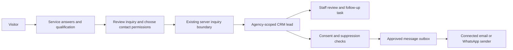

# AgencyDesk production and services chatbot plan

Research date: 15 October 2026. Status: proposal only; no chatbot installed, application implementation, database migration, live configuration change, commit, push or deployment performed for this plan.

## Recommendation

Launch a single-agency product first: public service pages and guided website chat feed AgencyDesk's existing lead pipeline; invited staff qualify inquiries, prepare proposals and manage projects; invited clients use the portal. Public SaaS registration and WhatsApp account login are separate future features.

Use **React ChatBotify** for the initial website assistant. Reuse its chat UI and conversation flow, plus the existing AgencyDesk inquiry, consent, CRM and message outbox. Start with approved service answers and qualification questions, without an LLM or API key. This provides useful chat without an additional model bill or dependence on the owner's PC. It is a guided assistant; describe it honestly rather than implying open-ended AI expertise.

Consider **Chatwoot Community Edition** later if a shared team inbox, live agent takeover and conversation management become requirements. It is closer to Zoko's inbox than a website widget, but creates a separate application to operate. A chatbot UI library alone is not a Zoko replacement.

ApartmentHub remains a reference for workflow patterns only. No credentials, contacts, sender identities, business copy or infrastructure are to be reused. No i18n is proposed. No paid resources or subscriptions are authorized by this plan.

## What exists today

These are audit observations, not proposed features:

| Area | Observed state | Practical implication |
| --- | --- | --- |
| Database access | All 19 public tables have RLS enabled. Lead policies enforce agency ownership; job/attempt reads are scoped to the staff agency. | A foundation for isolation exists. RLS enabled is not proof that every policy, privileged function or server endpoint is safe. |
| Privileged functions | Advisors flag public/authenticated SECURITY DEFINER helpers. Private ledgers deliberately have no direct user policies or grants. Leaked-password protection remains disabled. | Review function guards and effective privileges; do not add permissive policies simply to remove an advisory. |
| Authentication | Google/email login with active staff/client membership; invited accounts; public signup disabled. | No WhatsApp signup/login. Visitors can inquire without an account. |
| Leads | The intended AgencyDesk agency has **0 leads**. Eleven existing leads belong to another agency. | Do not present other-agency records as the owner's prospects. No prospect-discovery or lead-scraping feature is verified. |
| Website | Four services: business websites, website redesign, web applications/client portals, CRM and automation setup. Live service pages and inquiry flow were verified in the previous release. | Use this catalog as the assistant's source. Illustrative work must remain labelled. |
| Content publication | Production explicitly uses Git-backed fixture content. | Directus editing does not currently establish automatic production publication. Keep answers and pages in the same reviewed publication process. |
| Inquiry protections | Same-origin check and size/schema/catalog validation at the website route; persistent email-based limit and server-derived agency at the Edge function. | Extend existing protections rather than claiming none exist. Review direct Edge entry too: it currently checks service text length rather than the website's published catalog. Email-only limits can be evaded by changing email addresses. |
| WhatsApp | Linked WAHA sender and one earlier approved self-test verified. Full account/chat APIs are private; the public gateway is authenticated and send-only. Incoming chats are ignored. | Working test connection, not an inbound chatbot or unattended production service. |
| WhatsApp hosting | Local Docker/processes and a temporary Cloudflare tunnel require the PC awake; hostname changes on restart. | A stable operating environment is a prerequisite for reliable automated sending. |
| Gmail | Own send-only OAuth authorization connected. Google application remains External/Testing; no send test verified. | Current refresh-token lifetime is unsuitable for unattended ongoing use. Acceptance, delivery, bounces and replies are different capabilities. |
| Automation | Delivery mode is dry-run; no scheduler. Immediate inquiry acknowledgment requires approval; other rules remain disabled. | Customer automation has not been launched. |
| Verification | Previous release passed 87 unit tests, typecheck, lint and production build; earlier DB/Edge checks and one website-to-CRM inquiry are recorded in the hosting report. Actual mobile viewport validation remains unverified. | Historical checks are evidence, not a fresh full production certification. No test was rerun as part of writing this plan. |

Evidence: [hosting verification](hosting-verification.md), [messaging setup](../docs/messaging-setup.md), [content and automation](../docs/content-and-automation.md), application source and the hosted read-only RLS/policy/advisor/count audit performed for this request. Earlier entries in the hosting report describe earlier states; use its dated follow-ups.

## GitHub options researched

| Project | Fit and reuse | License/cost boundary | Decision |
| --- | --- | --- | --- |
| [React ChatBotify](https://github.com/react-chatbotify/react-chatbotify) | React conversation flows, options/checkboxes and custom components. Upstream declares React 19 support. Package metadata for 2.5.0 was inspected; no install or dependency audit was done. | MIT. Guided local flows need no model provider. Normal website hosting still applies. Preserve upstream license notices. | Preferred for the website FAQ and qualification assistant, subject to an isolated compatibility/accessibility check. |
| [Deep Chat](https://github.com/OvidijusParsiunas/deep-chat) | Customizable web component with React integration and custom server connections. Useful if open-ended AI chat becomes the main interface. | MIT. It supplies UI, not a complete CRM/helpdesk. Upstream warns that browser direct API connections expose provider keys and are for prototypes. Production provider requests must pass through a server. | Alternative if ChatBotify proves unsuitable, rather than adding both. |
| [Chatwoot](https://github.com/chatwoot/chatwoot) | Shared conversation inbox and human support workflows. Separate application, database, cache and background processes. | Community code is MIT except enterprise/third-party portions under their own licenses. Hosting and maintenance are separate costs; paid enterprise/AI capabilities must not be assumed included. | Later option when an actual shared inbox is needed. Do not replace the CRM just to add a website FAQ. |
| [Typebot](https://github.com/baptisteArno/typebot.io) | Visual conversation builder; attractive for nontechnical flow editing. | Current license is FSL-1.1-Apache-2.0 with competing-use restrictions and a future Apache grant, not an unrestricted MIT release. Deployment is another service to maintain. | Not the first choice for this product. Review the specific version and intended distribution before adoption. |

Sources: [ChatBotify quickstart](https://react-chatbotify.com/docs/v2/introduction/quickstart/), [Deep Chat connection guidance](https://github.com/OvidijusParsiunas/deep-chat#-direct-connection), [Chatwoot license](https://github.com/chatwoot/chatwoot/blob/develop/LICENSE), [Chatwoot deployment requirements](https://www.chatwoot.com/deploy), [Typebot license](https://github.com/baptisteArno/typebot.io/blob/main/LICENSE). These findings establish suitability for evaluation, not an audited security or maintenance guarantee. Recheck releases, advisories and transitive dependencies before adoption.

## Proposed visitor and lead flow

1. Offer service selection, help choosing, scope questions and a request for a human follow-up. Link answers to the corresponding service page.
2. Ask about the business goal, existing site/system, required features, desired timeframe and budget range. Make no pricing, delivery-time or availability promises absent approved content.
3. Let visitors browse answers without providing contact details. Before creating a lead, show the inquiry summary and collect the required contact fields. Explain what will be saved. Email and WhatsApp permissions remain separate and unchecked by default.
4. The current inquiry requires email, a sufficiently detailed brief and a numeric minimum budget. Design the chat around the actual schema; if "budget undecided" or phone-only inquiries are desired, propose an explicit validation/schema change rather than submitting a fabricated amount or email.
5. Submit through the shared server boundary. Record chatbot source and selected service; store optional qualification details in a structured, reviewed form or the brief. Derive the agency on the server. Visitors cannot select an agency, inspect CRM records, approve jobs or choose arbitrary sender identities.
6. Use an idempotency mechanism so retries create one inquiry. Do not automatically merge different people because a company name matches. Never inherit consent from another lead or from an earlier conversation.
7. Show a clear saved confirmation or a retryable error. A saved inquiry is not proof that an email/WhatsApp message was sent. Staff review and existing consent/suppression/approval logic determine the follow-up.
8. The initial "human handoff" creates a follow-up request in the CRM; it is not live chat. Do not claim an agent is online unless there is an actual staffed inbox.

Keep initial answers and transient conversation state in the page/session where possible. Persist the submitted inquiry rather than every anonymous keystroke. Define retention, deletion and access rules before adding stored chat transcripts. Attachments, audio and CRM-changing bot tools are outside the first release.

## Delivery phases and completion gates

### 1. Establish the production foundation

- Confirm hosting plan, intended commercial use, usage limits and cost controls. The Vercel team tool returned identity information but no billing plan; the actual plan remains unverified.
- Review Supabase advisor findings, privileged RPC guards, membership lifecycle and server-side tenant selection. Test anonymous, active/inactive staff, administrator and client access against different agencies, including attachments/storage and client portal boundaries where present.
- Audit signup/invite/reset/Google redirect behavior and staff offboarding. Require suitable administrator account protection. Check leaked-password protection availability before promising it on the current plan.
- Assess every public entry point, including direct Edge access: bounded bodies, schema parity, service allowlisting, safe errors, layered throttling and bot protection as needed. Preserve the persistent existing inquiry limit.
- Establish exports/backups with a restore rehearsal, operational alerts, secret rotation procedure, incident owner, privacy/contact consent wording, retention/deletion process and a rollback procedure.
- Verify actual phone browsers, keyboard/screen-reader behavior, inquiry success/failure and owner login in production-like conditions. Record a practical uptime/recovery target and whether the selected free tiers can support it.

Gate: isolation tests pass; direct entry points cannot bypass intake rules; a backup can be restored; mobile and core inquiry/login/portal flows pass; hosting terms and operational limits are documented.

### 2. Evaluate and add the guided website assistant

- After implementation is authorized, pin one reviewed ChatBotify version. Read the repository's installed Next.js guides, isolate browser-only code and load the widget on demand on public pages.
- Reuse the service catalog and existing inquiry infrastructure; add only the business flow and adapter. Avoid exposing private workspace data or keys to the client.
- Evaluate a representative FAQ set covering all four services, unknown questions, custom pricing, unrealistic deadlines, customer secrets, off-topic requests and malicious markup. Fallback to an honest follow-up request.
- Test keyboard focus/close/escape, screen-reader labels, small screens, slow networks, repeated submission, consent changes, API errors and cross-agency attempts. Keep the ordinary inquiry form usable if chat fails.

Gate: approved catalog answers; one submitted chat creates one correctly scoped lead; opt-out produces no send; no fabricated promises, browser secrets or private CRM access; acceptable accessibility and page performance.

### 3. Make outbound channels sustainable

- Resolve Gmail's Testing token limitation through an appropriate production OAuth configuration and any required review, or evaluate an owner-controlled transactional email provider. Do not assume publishing the consent screen alone resolves all Google requirements.
- Define delivery/error handling and operational checks. Request a specific, bounded own-recipient email test when appropriate; prior WhatsApp self-test approval is already consumed.
- Choose the WhatsApp operating model. The existing unofficial WAHA connection avoids Meta onboarding but retains linked-session and account-restriction risk. Stable hosting, session recovery, persistent storage, security patches and monitoring are still required. Official WhatsApp is a separate provider/business setup and must be evaluated with current terms and charges.
- Keep the full account/chat API private. Separate secrets per channel; maintain agency/sender binding and verified receipts. Avoid blind retries when the provider outcome is uncertain.

Gate: credentials survive normal operation; transport restarts recover safely; delivery states are distinguished from API acceptance; failures alert the owner; only explicitly approved tests have been sent.

### 4. Release automation gradually

- Exercise the actual lead-to-job flow in dry-run, including duplicate requests, declined permission, recipient suppression, approval, expired claims, provider timeout, duplicate receipts and cancellation.
- Introduce a secured scheduler with bounded batches, per-channel caps, quiet hours, audit records and a clear pause control. Resolve scheduling/hosting quotas before relying on it.
- Start with reviewed inquiry acknowledgments. Enable additional follow-ups only after their trigger, timing, channel permission, stop conditions and content are approved. No prospect scraping or unsolicited campaigns are part of this plan.

Gate: one event produces the intended job once; suppression/withdrawal stops eligible jobs; unknown outcomes require reconciliation rather than automatic duplicate sending; logs and monitoring explain failures.

### 5. Optional inbound WhatsApp and AI

This is a separate later phase. The current gateway exposes no incoming-message access. An inbound integration would need a narrowly scoped authenticated webhook, event deduplication, sender/session checks, tenant-bound conversation state, retention controls, loop prevention, opt-out recognition, abuse limits and staff takeover. Do not expose WAHA's administrative/chat-reading APIs to add it. Confirm the intended incoming-message access before activating it.

Phone number ownership, a WhatsApp conversation and permission to send updates do not establish an authenticated client portal session. Keep staff/client identity on invited Google/email accounts unless a separate phone-auth requirement is approved. Supabase's documented WhatsApp OTP path currently uses Twilio/Twilio Verify; WAHA pairing does not add WhatsApp login to Supabase.

An LLM can be evaluated later for natural-language phrasing or catalog retrieval, with server-only credentials, bounded public knowledge, refusal/fallback behavior, spending limits and an evaluation set. The small local Hermes model previously invented business facts and had timeout/cold-start issues; it is not the production public assistant recommendation. No LLM may send messages, change prices, approve leads or access private records merely because it is asked to in chat.

## Free-first hosting and cost decision

| Component | Proposed position | Remaining limit |
| --- | --- | --- |
| Guided website assistant | MIT library within the existing site; no model API required. | Website hosting, usage and maintenance still apply. |
| Vercel | Verify the actual plan before commercial launch. | [Hobby is restricted to non-commercial personal use](https://vercel.com/docs/plans/hobby). No upgrade or purchase has been made. |
| Netlify alternative | Evaluate a preview only if a free commercial host is needed. Its official Free introduction permits commercial projects. | Current pricing lists 300 monthly credits and pauses projects on exhaustion. The older announcement's numeric limits are obsolete; use current pricing. Next 16.3.8, SSR, server actions, cookies and OAuth must pass a migration proof before switching DNS. |
| Cloudflare alternative | Secondary compatibility investigation. | Current Next guidance recommends vinext, explicitly beta, with a compatibility review. It is not assumed to be a drop-in migration for this application. |
| Supabase | Retain the existing project and RLS model. | Verify current quotas, inactivity behavior and backup/recovery availability; do not equate a free database with guaranteed production uptime. |
| WAHA/Chatwoot hosting | No additional deployment proposed yet. | Long-running containers and durable session storage need an operating host. Website serverless hosting is not automatically a home for these services. No guaranteed free always-on host has been established. |

Sources: [Netlify commercial-use statement](https://www.netlify.com/blog/introducing-netlify-free-plan/), [current Netlify pricing and exhaustion behavior](https://www.netlify.com/pricing/), [current Cloudflare Next.js guidance](https://developers.cloudflare.com/workers/framework-guides/web-apps/nextjs/). Free-only operation can be a limited pilot; uninterrupted production messaging has not been demonstrated at zero operating cost. A domain, paid hosting or provider charges would require a separate decision, not an automatic subscription.

## Decisions needed before implementation

The proposed defaults are website-first, guided answers, existing invited login, single-agency CRM, submitted inquiry storage and reviewed outbound messaging. No new plugin is required to finish this research or to use an npm UI library later.

Before launch, confirm approved FAQ/business facts, response expectations, privacy/retention text and the hosting cost/reliability tradeoff. Prices and delivery commitments remain absent until supplied. WhatsApp inbound access, public self-signup, a staffed live inbox and open-ended AI require separate scope decisions.

The work is complete as a research plan. The product should not be labelled production-ready until the applicable gates above pass and the remaining operational limits are explicitly accepted.

## Additional authoritative references

- [Supabase production checklist](https://supabase.com/docs/guides/deployment/going-into-prod).
- [Supabase WhatsApp/phone authentication](https://supabase.com/docs/guides/auth/phone-login).
- [Google OAuth refresh token expiration](https://developers.google.com/identity/protocols/oauth2#expiration): External/Testing refresh tokens expire in seven days except the documented basic-profile scope exception; the connected Gmail grant uses a sending scope.
- [Supabase privileged-function advisory](https://supabase.com/docs/guides/database/database-linter?lint=0029_authenticated_security_definer_function_executable), [anonymous function advisory](https://supabase.com/docs/guides/database/database-linter?lint=0028_anon_security_definer_function_executable), [RLS without policy advisory](https://supabase.com/docs/guides/database/database-linter?lint=0008_rls_enabled_no_policy), [password protection](https://supabase.com/docs/guides/auth/password-security#password-strength-and-leaked-password-protection).
