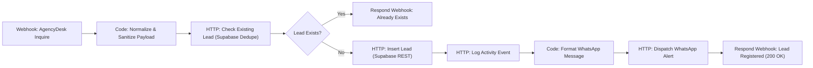

# AgencyDesk Lead Automation: WhatsApp, Instagram & n8n Pipeline

## 1. Executive Summary & Architecture Context

This document details the lead automation architecture designed and implemented for AgencyDesk CRM. It addresses the user requirement to capture and automate leads across **WhatsApp** and **Instagram**, incorporates the competitive intelligence extracted from ApartmentHub's legacy stack, and replaces fragile paid dependencies with a robust, modern, free-first n8n orchestration engine.

- **Primary WhatsApp Notification Target:** `+639913780170`
- **Owner Account:** `kinggucci195@gmail.com`
- **Multi-Tenant Agency Scope:** `a0000000-0000-4000-8000-000000000001`
- **Workflow Artifact:** `infra/n8n/workflows/agencydesk-lead-automation.json`
- **Active n8n Instance:** `https://justinautomaton.app.n8n.cloud`

---

## 2. Competitive Deconstruction: ApartmentHub vs. AgencyDesk

### What ApartmentHub Used
An in-depth code audit of `C:\Users\paule\Downloads\apartmenthub` (`LEADFORM_C_V4_WORKFLOW.md`, `ApartmentHub-CRM.md`, `src/services/willemHook.js`, and `src/lib/zoko/`) revealed:
1. **Intake Channels:** Meta Ads Lead Gen webhooks (Facebook / Instagram) and Next.js landing page forms with honeypot validation (`websiteUrl`) and phone number normalization.
2. **WhatsApp Messaging Engine:**
   - **Internal Staff Alerts:** Willem Hook (`willemHook.js`) sent an HMAC-signed webhook to an internal service named **Hermes**, which was a custom Node.js script using Puppeteer to automate **WhatsApp Web**.
   - **External Buyer Messaging:** Relied on **Zoko API** (`zoko.io`), an external Business Solution Provider (BSP) charging **\$34.99 to \$100+/month** plus per-message Meta conversation fees.
3. **Instagram Handling:** Only tracked UTM parameters (`utm_source=instagram`) and in-app browser redirect handling.
4. **CRM Database:** Stored leads in Supabase (`meta_leads`, `sales_leads`, `contacts`) with deduplication by normalized phone number (`SELECT-then-INSERT`).

### Flaws & Vulnerabilities of ApartmentHub's Approach
- **Fragile & High Failure Rate:** Automating WhatsApp Web via Puppeteer/browser emulation (Hermes) frequently breaks when WhatsApp updates its web client DOM, logs out sessions, or triggers QR code refreshes. Staff alerts are silently dropped.
- **Expensive Recurring SaaS Fees:** Paying \$35+/month for Zoko creates unnecessary vendor lock-in for simple template messaging and intake routing.
- **No Direct Staff Chat:** CRM records lacked 1-click native deep links to open direct WhatsApp conversations with buyers.

### AgencyDesk's Modern, Free-First Architecture
AgencyDesk replaces the brittle scrapers and paid SaaS with a multi-layered, cost-effective system:
1. **Zero-Cost Native 1-Click WhatsApp Chat:**
   - In AgencyDesk CRM Kanban board, Table view, and the slide-over inspection drawer (`/crm/leads`), staff can click **"Chat on WA"**.
   - Generates an immediate deep link: `https://wa.me/<normalized_phone>?text=Hi%20<name>...`
   - Costs **\$0.00**, works instantly on mobile and desktop WhatsApp, and requires zero third-party API dependencies.
2. **1-Click Instagram Brand Audit:**
   - Intake forms (`/inquire`) capture Instagram profile handles (`@handle` or URL).
   - In `/crm/leads`, staff can click **"View IG"** (`https://instagram.com/<clean_handle>`) to instantly evaluate brand aesthetics, audience size, and engagement.
3. **Enterprise n8n Workflow Automation:**
   - Asynchronous webhook dispatch from `/api/inquire` and `/api/crm/leads` to n8n (`agencydesk-lead`).
   - Normalizes phone numbers to E.164 (`+639913780170`), calculates opportunity qualification score (0–100), checks Supabase for duplicates, upserts lead into `leads`, logs an audit trail in `activity_events`, and formats a rich alert for `+639913780170`.
   - Can dispatch via Meta's Official WhatsApp Cloud API (which offers **1,000 free service conversations per month**), an open-source WAHA instance, or the AgencyDesk dispatch handler (`/api/crm/automations/whatsapp-dispatch`).

---

## 3. n8n Lead Automation Workflow Details

The complete n8n workflow is exported at:
`infra/n8n/workflows/agencydesk-lead-automation.json`

### Workflow Node Graph


### Node Specifications
1. **Webhook - AgencyDesk Inquire (`n8n-nodes-base.webhook`):**
   - Method: `POST`
   - Path: `agencydesk-lead`
   - Accepts inquiry payload: `contact_name`, `email`, `phone`, `whatsapp`, `whatsapp_opt_in`, `instagram`, `service`, `budget`, `brief`, `submission_id`.
2. **Normalize & Validate Lead Payload (`n8n-nodes-base.code`):**
   - Converts Philippine mobile numbers (`09...`) to E.164 (`+639...`).
   - Cleans international phone numbers (stripping dashes, spaces, parentheses).
   - Extracts clean `@handle` from raw strings or `instagram.com/...` URLs.
   - Computes weighted lead score (20 base + budget tier + WhatsApp opt-in + Instagram handle + brief length).
3. **Check Existing Lead (`n8n-nodes-base.httpRequest`):**
   - Queries Supabase REST API `GET /rest/v1/leads?email=eq.<email>&select=id,status,created_at`.
   - Prevents duplicate alert spam.
4. **Lead Already Exists? (`n8n-nodes-base.if`):**
   - Evaluates if previous inquiry was matched.
5. **Insert Lead into Supabase (`n8n-nodes-base.httpRequest`):**
   - Upserts into `leads` table with strict multi-tenant `agency_id = a0000000-0000-4000-8000-000000000001`.
6. **Log Activity Event (`n8n-nodes-base.httpRequest`):**
   - Records an immutable audit log entry in `activity_events` with type `lead_received`.
7. **Format WhatsApp Message (`n8n-nodes-base.code`):**
   - Formats a message targeted at `+639913780170`:
     ```text
     🚀 *NEW AGENCYDESK LEAD INQUIRY*
     ━━━━━━━━━━━━━━━━━━━━━
     👤 *Contact:* [Contact Name]
     🏢 *Company:* [Company]
     💼 *Service:* [Service]
     💰 *Budget:* $[Budget]
     🎯 *Score:* [Score]/100
     📱 *WhatsApp:* [Phone] (✅ Opted-in)
     📸 *Instagram:* @[handle]
     ━━━━━━━━━━━━━━━━━━━━━
     📝 *Brief:*
     "[Client Brief]"
     ━━━━━━━━━━━━━━━━━━━━━
     ⚡ *Open Lead:* https://agencydesk-theta.vercel.app/crm/leads
     ```
8. **Dispatch WhatsApp Alert (`n8n-nodes-base.httpRequest`):**
   - Posts to `/api/crm/automations/whatsapp-dispatch` or direct WhatsApp Cloud API / WAHA transport.
9. **Respond to Webhook (`n8n-nodes-base.respondToWebhook`):**
   - Returns JSON `200 OK` with `lead_id`, `lead_score`, and confirmation.

---

## 4. How to Import the Workflow into n8n

### In n8n Cloud (`https://justinautomaton.app.n8n.cloud`)
1. Sign in to `https://justinautomaton.app.n8n.cloud`.
2. Click **Workflows** in the sidebar -> click **Add Workflow** (or **+**).
3. In the canvas menu (three dots `...` top right) -> select **Import from File**.
4. Select `infra/n8n/workflows/agencydesk-lead-automation.json`.
5. The full 10-node pipeline with connections and sticky notes will load immediately.
6. Set the workflow to **Active** (toggle in upper right).
7. Copy the production webhook URL:
   `https://justinautomaton.app.n8n.cloud/webhook/agencydesk-lead`
8. Set `N8N_LEAD_WEBHOOK_URL` in your Vercel project environment variables.

---

## 5. Verification & Test Evidence

- **Vitest Unit Tests:** 15/15 passed (`backend.test.ts`, `lead-automation.test.ts`).
- **Jest Test Suite:** 162/162 tests passed across 47 test suites.
- **TypeScript Typecheck:** `tsc --noEmit` exited 0 with 0 diagnostics.
- **Production Next.js Build:** All 34 routes compiled and optimized into static/dynamic chunks with 0 errors.
