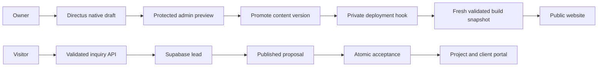

# Content, CRM and future automation

## What this solves

Directus gives the owner an editor for public copy instead of requiring a code
change for each wording update. Native versions keep unfinished edits away from
published content. A restricted build reader prevents drafts and account data
from entering the public website.

Next.js prepares a public-only content snapshot during every build. Visitors
read that deployed snapshot, so CMS sleep or downtime does not interrupt the
website. Failed content reads or invalid content fail the new deployment while
the previous deployment remains available.

Supabase continues to own authentication and the inquiry-to-delivery workflow.
Moving CRM records into the CMS would duplicate authorization and transactional
rules. Keeping those responsibilities separate makes permission changes and
proposal acceptance easier to verify.

## Workflows

The hosting checks passed and production now uses CMS content. Owner sign-in
and private draft preview are verified. The publishing hook still awaits
explicit approval; the diagram includes that pending step. Until it is
connected, production Git/CLI deployments fetch fresh published CMS content.

## Business automation and future analytics

The October 14 implementation adds lead activity/callback commands and a transactional message queue using existing committed activity events. Four disabled rules cover inquiry acknowledgment, proposal notice, delayed follow-up, and acceptance confirmation. An Edge worker delivers dry-run simulations or own-account Resend/Meta messages, and verified callbacks record delivery separately. See [messaging setup](messaging-setup.md) for migration, worker deployment, secret, and scheduler configuration. Hermes and inbound-reply automation remain future extensions.

Use browser analytics for page views and interface interactions. Use confirmed
server/database events for business outcomes: inquiry received, proposal
published, proposal accepted, project created and milestone completed. A browser
click alone cannot establish that an acceptance transaction succeeded.

The message outbox is created alongside the committed Supabase transaction.
Jobs reference a unique activity event, rule and channel; workers use leases,
current eligibility checks, bounded known-safe retries, and provider receipts.
External delivery failures cannot roll back accepted proposals. Future n8n or
Zapier consumers should receive narrowly scoped authenticated events and use
the same event identity for deduplication.

Keep content publication events in Directus and business events in Supabase.
Grant each integration only the access it needs. Do not give analytics or
automation tools an owner credential, CMS database password, or blanket CRM
access. Start with minimal event data and add contact information only where
the workflow requires it.

This is a useful portfolio architecture: it demonstrates editing, publication,
permissions and transactional business behavior. The free Render service is an
experimental hosting choice with slow cold starts; its limits still need to be
reconsidered if the project later has real users or editing availability needs.
Analytics and n8n/Zapier implementation remain deferred.
