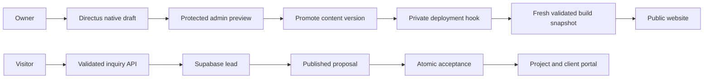

# Website publication and CRM automation

## Current deployment — 15 October 2026

The public website and staff/client routes are deployed together in the existing
AgencyDesk Vercel project. The production Git branch is `codex/leads-automation`.
An authorized push builds a validated public content snapshot and assigns the
successful production deployment to `https://agencydesk-theta.vercel.app`.

Production currently explicitly uses `CONTENT_SOURCE=fixtures`: approved public
copy lives in `content/fixtures.json`. The Directus reader previously failed a
production build; its configuration is retained for repair. **CMS edits and its
publishing hook are not currently the production publication path.** Do not
describe a CMS draft or promotion as live until a successful deployment proves it.

The catalog includes business websites, website redesign, web applications/client
portals, and CRM/automation setup. Each visible service gets a generated detail
page and an inquiry link that preselects its catalog entry. Archived services
are excluded from pages, inquiry choices, and the sitemap. Unknown service routes
return not found; the inquiry API rejects choices absent from the deployed catalog.
Sample projects remain explicitly illustrative rather than claimed client work.

The public sitemap lists marketing pages only. CRM, portal, login, and demo pages
are excluded and use appropriate crawl controls. Authentication and tenant rules
remain the actual access controls. Each service has its own description and
canonical URL; inquiry query parameters do not create duplicate canonical pages.

## What this solves

Directus gives the owner an editor for public copy instead of requiring a code
change for each wording update. Native versions keep unfinished edits away from
published content. A restricted build reader prevents drafts and account data
from entering the public website.

Next.js prepares a public-only content snapshot during every build. Visitors
read that deployed snapshot, so CMS sleep or downtime does not interrupt the
website. Failed content reads or invalid content fail the new deployment while
the previous deployment remains available.

Supabase continues to own authentication and the inquiry-to-delivery workflow.
Moving CRM records into the CMS would duplicate authorization and transactional
rules. Keeping those responsibilities separate makes permission changes and
proposal acceptance easier to verify.

## Workflows

The diagram describes the prepared CMS publication architecture. The current
production source and the incomplete CMS publication boundary are stated above.
Protected draft preview is separate from deploying a public content snapshot.

## Business automation and future analytics

The CRM uses lead activity/callback commands and a transactional message queue. Rules cover inquiry acknowledgment, proposal notice, delayed follow-up, and acceptance confirmation. Only the own agency's WAHA inquiry acknowledgment currently queues for staff approval; the worker remains in dry-run and no scheduler is configured. Own Gmail send-only authorization is configured, with a live send test still pending and a seven-day Google Testing token lifetime. See [messaging setup](messaging-setup.md) for current provider and deployment boundaries. Hermes hosting and inbound-reply automation remain incomplete.

Use browser analytics for page views and interface interactions. Use confirmed
server/database events for business outcomes: inquiry received, proposal
published, proposal accepted, project created and milestone completed. A browser
click alone cannot establish that an acceptance transaction succeeded.

The message outbox is created alongside the committed Supabase transaction.
Jobs reference a unique activity event, rule and channel; workers use leases,
current eligibility checks, bounded known-safe retries, and provider receipts.
External delivery failures cannot roll back accepted proposals. Future n8n or
Zapier consumers should receive narrowly scoped authenticated events and use
the same event identity for deduplication.

Keep content publication events in Directus and business events in Supabase.
Grant each integration only the access it needs. Do not give analytics or
automation tools an owner credential, CMS database password, or blanket CRM
access. Start with minimal event data and add contact information only where
the workflow requires it.

This is a useful portfolio architecture: it demonstrates editing, publication,
permissions and transactional business behavior. The free Render service is an
experimental hosting choice with slow cold starts; its limits still need to be
reconsidered if the project later has real users or editing availability needs.
Analytics and n8n/Zapier implementation remain deferred.
