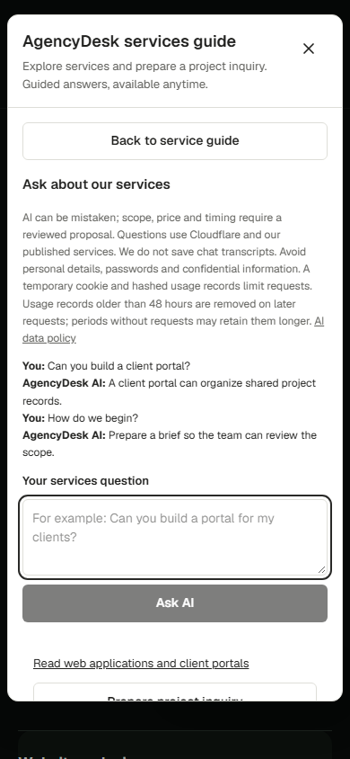
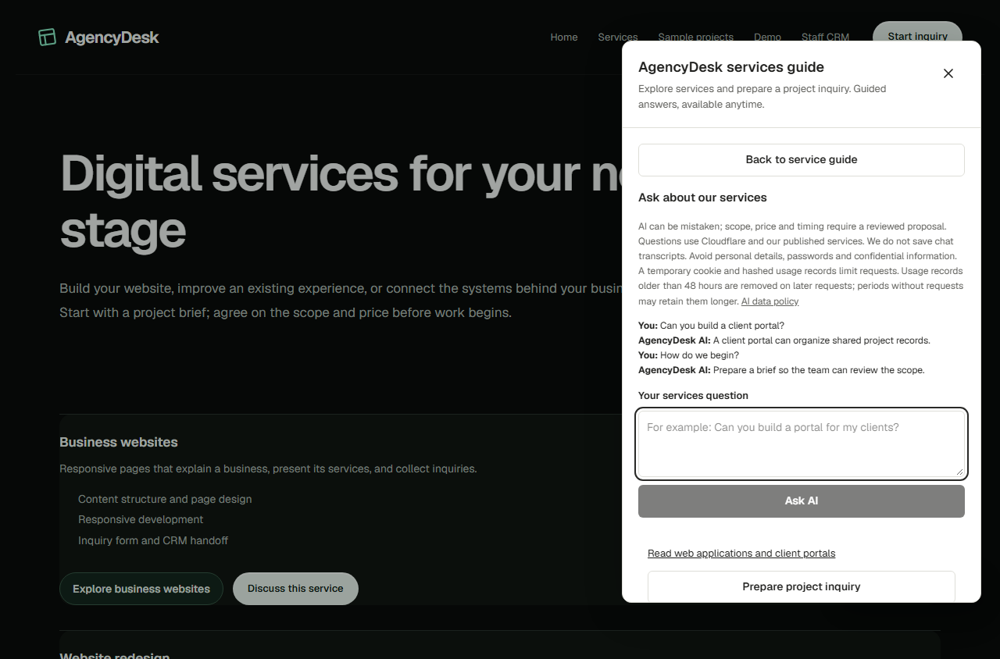

# Public service-chat source verification - 31 October 2026

This continues Task1 of the approved 19 October free-first CRM plan after owner-merged UI PR4 and setup PR5. Scope is the existing public services widget, Next relay and private quota-backed Edge boundary. It is a disabled-by-default source release for owner review, not a verified hosted AI service. n8n hosting remains planning-only; PR6 and all root CI/n8n/operating-cap WIP are separate.

## Behavior and fixes

The guide discovers a runtime no-store capability when opened, preserving guided service choices when discovery is off, slow, aborted or unavailable. An enabled test capability opens a plain-text AI composer with up to three bounded previous questions, second-turn continuation, focus restoration, a 16 second client deadline, service detail links and explicit inquiry handoff. Consent remains unchecked and no form submits automatically. ChatBotify persistence is disabled; React state holds temporary conversation/history until close.

Next checks the configured origin, server flag and relay configuration. A signed HttpOnly/Secure/SameSite cookie selects pseudonymous session identity; trusted Netlify connection metadata is hashed rather than accepting visitor-selected hashes. The Edge checks its relay and server flag before admission/model access; its server-configured agency and private service-only quota RPCs remain authoritative. Public prompts use published service facts only, with no CRM tools, client data, sending or bookings. Regex output checks do not guarantee factuality.

Three reproduced reliability defects were corrected: missing Edge database configuration now yields redacted 503 instead of escaping try; malformed/oversized provider or relay JSON yields upstream 503 while visitor validation remains 400/413; failure to record quota completion cannot return a successful answer or retry inference. Attempts remain counted. Independent review also found AI->inquiry->Back to guide returning to AI. A browser assertion failed on the old built UI; clearing both inquiry and AI modes makes the same assertion pass.

## Exact local evidence

- 144 unit tests across 20 files pass, including signed-session/route/provider cases. Initial provider/relay malformed-body tests failed before fixes; missing-config/completion Edge cases failed before fixes.
- 5 Edge tests pass with runtime network access denied, using intercepted requests only. These cover direct/forged relay refusal, disabled state, missing identity/configuration, quota refusal, one admitted inference and completion failure.
- 150 private quota assertions pass with embedded PostgreSQL: denied anon/authenticated access, session/network/agency/day/in-flight caps, replay, separate-agency hashes and retention. This is separate from real-session concurrency evidence.
- 17 additional assertions pass using a disposable official PostgreSQL 17 image pinned to sha256:31ba9c94a03ada9988f2bb493a22a75eef3a185884533e5cdbcd498ea835b08f. Three batches hold the agency advisory lock, observe all 8 callers blocked, release it and verify unique backend PIDs/session-global-daily results. A removed-lock negative control in that disposable database is refused. No source migration is changed. Network none, no host port/mount, bounded resources/tmpfs and finally cleanup; no hosted credentials or customer data. Opt in with AGENCYDESK_ALLOW_LOCAL_DOCKER_TEST=1 and pnpm test:chat-concurrency.
- Network-enabled pnpm build --webpack passes including TypeScript/static generation/tracing. The known local dependency-junction Turbopack issue is not claimed fixed. No default build or production check is inferred from Webpack.
- All 12 browser scenarios at 390px/1280px/1440px pass serially on the final built snapshot, including two answers/history, delayed capability, quota/error fallback, timeout/close abort, focus, guide return, overflow, Axe and unchecked inquiry permissions. Model responses are intercepted; no CRM form is submitted. One first green attempt failed at test loading because screenshot import.meta was incompatible with this CommonJS harness; portable test.info().file/path resolution fixed only that harness path.
- TypeScript noEmit/scoped ESLint and full database/Edge suite outcomes are recorded in the PR and local ledger. Missing/incomplete checks must remain explicit.

## Screenshots

These are actual local browser renders with intercepted test answers, not live provider results or customer conversations. No operational leads, metrics or testimonials were added.

## Security, costs and activation

Independent read-only security/final review covered the scoped Next/React/TypeScript/Supabase seams. The guide-return P2 was reproduced and fixed, and concurrency evidence was strengthened with observed lock waiters/negative control. Secrets stay server-only; the website host needs only its relay, not service-role/provider sender credentials. Exact staging/private ignores and redacted known-format scans are required before push, with scope/limits in the PR. They are not a zero-leak guarantee or full history/provider/dependency audit.

Keep SERVICE_CHAT_ENABLED=false in the website and Edge until separate owner-authorized activation. No provider token/account or current Free entitlement is verified here. Existing model IDs remain candidates; a 30 case model evaluation, budget/token/reasoning behavior, actual provider privacy review and hosted browser verification remain outstanding. No credits, purchase, paid fallback or recharge was enabled. No database migration, Supabase/Cloudflare access, customer message or appointment occurred. The existing quota migration was copied byte-for-byte; confirm own account/project binding and applied migration history before deployment.

Source rollback is a scoped revert through owner review. Runtime rollback is switch-off while retaining the ordinary guide; do not delete quota history or revoke/rotate credentials without the required authorization. Retention is admission-time cleanup plus optional service-only maintenance, not a guaranteed 48 hour deletion timer. Production release remains owner-controlled, and CI must not be called green while Deno setup fails.

Final full-suite results: all 610 database assertions across eight embedded PostgreSQL suites pass, all 44 Edge tests pass without runtime network access, TypeScript noEmit passes, and scoped ESLint reports zero errors/warnings. Local browser evidence is from the final application build.

Pre-publication evidence: exact 24-file staged allowlist/snapshot equality; three representative private paths ignored. Known-format scan reports 22 staged text files with no findings and two manually inspected PNGs; current tracked index 362 text files, 18 binary/large skips, no findings. Built public assets: 87 text files, zero source maps, no findings. No history, private credential stores, server/deployed artifacts or dependency/image vulnerability audit is implied.

Wide-desktop completion: all 12 browser cases pass in 50.8 seconds at 390/1280/1440, preserving the original eight scenarios and adding four wide-desktop cases. Only the original mobile/desktop screenshots are published; the 1440px capture stays in private test artifacts.
